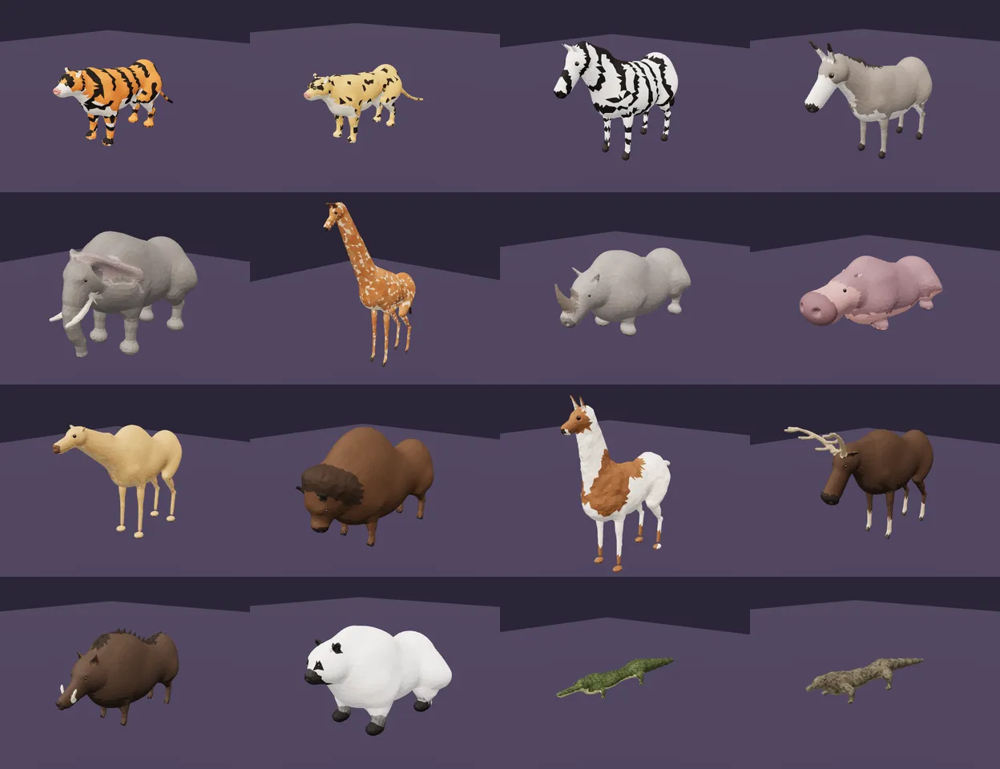
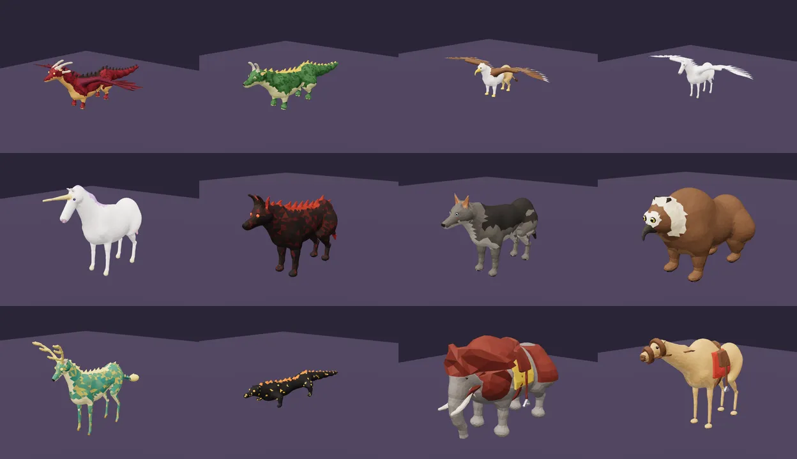
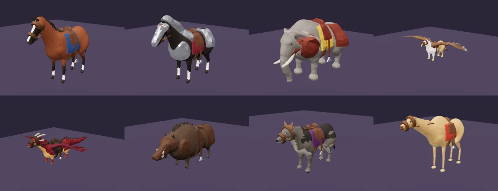

# BadZoo

**Procedural low-poly animals, monsters and mounts that are sculpted, not assembled.**
*Bad Ideas Works: We Create Worlds. Badly. Now with livestock.*

BadZoo is BadCharacters' sibling for four-legged things. It produces game-ready quadrupeds as
skinned, rigged, animated GLBs: one continuous faceted surface, a painted coat, glossy eyes, a
quadruped skeleton and procedural gaits, all from a seed-reproducible recipe.






- **App:** `npm install && npm run dev`
- **Rig / export contract:** [`docs/RIG.md`](docs/RIG.md)

## What you get

| | |
|---|---|
| Real animals (28) | Dog, Wolf, Fox, Cat, Lion, Tiger, Leopard, Horse, Zebra, Donkey, Cow, Bison, Pig, Boar, Sheep, Goat, Llama, Camel, Deer, Moose, Giraffe, Elephant, Rhino, Hippo, Bear, Panda, Crocodile, Monitor lizard |
| Fantasy (10) | Dragon, Drake, Griffin, Pegasus, Unicorn, Hellhound, Dire Wolf, Owlbear, Kirin, Salamander |
| Mounts (8) | Riding Horse, Warhorse, Caravan Camel, War Elephant, Griffin Rider, Dragon Rider, War Boar, Wolf Rider (any animal can wear tack) |
| Hybrids | Cross-breed any two species with a slider (numbers and colours blend, horns grow in) |
| Anatomy | Legs: digitigrade / unguligrade / plantigrade / **sprawling**; feet: paw / hoof / cloven. Nose: pad / snout / broad / **beak**. **Trunk**, **tusks**, horns (cow, ram, goat, antlers, unicorn, **rhino**, **dragon**), 1–2 humps, **dorsal spines**, manes, floppy-to-pointy ears, tails with brush, curl and tuft |
| Wings | **Membrane** (scalloped bat/dragon wings with finger bones) or **feathered** (layered feather cards), with their own bones and a Fly clip |
| Tack | Blanket, saddle with girth and stirrups, bridle with reins draped over the crest, **leather or plate barding** (crinet, peytral, crupper, chanfron). Every piece is a shell of the animal's own sculpt, so it fits anything |
| Coat | Countershading, solid / spots / rosettes / stripes / tabby / patches / saddle / colour points / **scales** / **split**, socks, blaze, eye patches, ear and tail tips, wool, glowing eyes |
| Rig | 33 core bones (+3 per wing, +3 for a trunk), identity rest rotations, `Socket_Saddle` (rider) and `Socket_Head` |
| Animations | Idle, Walk (lateral sequence), Trot (diagonal), Gallop (rotary, with spine flex), Eat, Fly (winged); lizards wriggle their spines, wings fold when grounded, trunks sway |
| Export | GLB (Khronos-validator clean), `.badzoo.json` recipe, share links |
| Budget | 600–12k triangles (default ~4.5k) |

## How it works (short version)

1. **Anatomy → sculpt.** The recipe places joints the way a real quadruped's sit (sloped
   shoulder blade, elbow tucked at the brisket, raised hock for toe-walkers). It then hangs about
   60–100 signed-distance "clay" shapes on them: ribcage, rump, haunches, triceps, gaskins,
   cheeks, brows, cupped ears, nostrils and eye sockets (carved). These are blended with a
   smooth minimum.
2. **Surface nets** turn the sculpt into one closed surface (~50k triangles).
3. **Quadric decimation** reduces it to the budget. It keeps the mesh manifold, rejects
   fold-overs and **spends triangles on the face**: the nose, muzzle and ears get 5–9× importance.
4. **Skinning comes from the sculpt.** Every shape knows which bones it follows, so each vertex
   listens to the shapes it sits on.
5. **Painting** gives each facet one colour from what it is (nose, hoof, inner ear), which way it
   faces, and 3D pattern fields. A majority filter then removes stray "torn" triangles.
6. **Gaits** come from real footfall orders, with IK legs so stance feet stay planted.

The viewer **renders the exported GLB**, the same file your engine gets.

## Commands

```bash
npm run dev                              # the app
npm test                                 # 233 tests: manifold meshing, feet on floor, weights, NaN-free clips, features present, validator-clean GLB for all 46 presets
npm run cli -- export horse 3 out/       # one animal → GLB + recipe
npm run cli -- samples out/samples       # every species
```

## Status (honest version)

| Area | State |
|---|---|
| Sculpt → mesh → decimate → skin → paint | ✅ working, ~0.6–3 s per animal in a Web Worker (armoured mounts up to ~5 s) |
| GLB export | ✅ Khronos validator: 0 errors on all 46 presets |
| Tack | ✅ fits every body plan; reins are skinned rope, so extreme head poses can stretch them |
| Wings | ✅ fold / flap; Fly is a hover-ish cycle, no glide or take-off yet |
| Gaits | ✅ procedural and IK-planted; walk/trot look right, gallop is plausible rather than beautiful |
| Unity / Godot / Unreal import | ⚠️ not yet verified in those editors (Generic rig; no Humanoid mapping for quadrupeds) |
| Birds, snakes, fish, insects, six-legged things | ❌ not yet: other body plans are the next archetypes |
| Facial animation / mouth | ❌ the jaw doesn't open yet |
