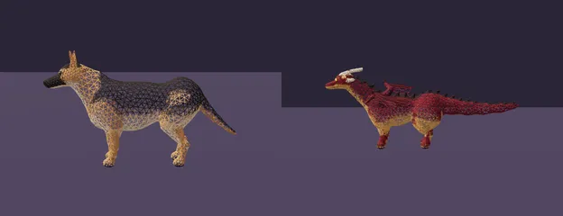
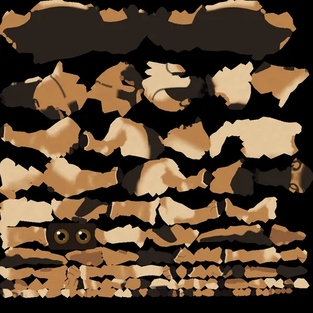

# BadZoo

**Procedural low-poly animals, monsters and mounts that are sculpted, not assembled.**
*Bad Ideas Works: We Create Worlds. Badly. Now with livestock.*

BadZoo is BadCharacters' sibling for four-legged things. It produces game-ready quadrupeds as
skinned, rigged, animated GLBs: one continuous faceted surface, a painted coat, glossy eyes, a
quadruped skeleton and procedural gaits, all from a seed-reproducible recipe.


| Topology (remeshed, wireframe) | Baked atlas (dog) |
|---|---|
|  |  |

- **App:** `npm install && npm run dev`
- **Devlog:** `devlog.html` on the site: the intake journal of the BadZoo Sanctuary for Traumatised Low-Poly Creatures (non-technical, mostly true)
- **Rig / export contract:** [`docs/RIG.md`](docs/RIG.md)

## What you get

| | |
|---|---|
| Real animals (28) | Dog, Wolf, Fox, Cat, Lion, Tiger, Leopard, Horse, Zebra, Donkey, Cow, Bison, Pig, Boar, Sheep, Goat, Llama, Camel, Deer, Moose, Giraffe, Elephant, Rhino, Hippo, Bear, Panda, Crocodile, Monitor lizard |
| Fantasy (10) | Dragon, Drake, Griffin, Pegasus, Unicorn, Hellhound, Dire Wolf, Owlbear, Kirin, Salamander |
| Mounts (8) | Riding Horse, Warhorse, Caravan Camel, War Elephant, Griffin Rider, Dragon Rider, War Boar, Wolf Rider (any animal can wear tack) |
| Hybrids | Cross-breed any two species with a slider (numbers and colours blend, horns grow in) |
| Anatomy | Legs: digitigrade / unguligrade / plantigrade / **sprawling**; feet: paw / hoof / cloven. Nose: pad / snout / broad / **beak**. **Trunk**, **tusks**, horns (cow, ram, goat, antlers, unicorn, **rhino**, **dragon**), 1–2 humps, **dorsal spines**, manes, floppy-to-pointy ears, tails with brush, curl and tuft |
| Wings | **Membrane** (scalloped bat/dragon wings with finger bones) or **feathered** (layered feather cards), with their own bones and a Fly clip |
| Tack | Blanket, saddle with girth and stirrups, bridle with reins draped over the crest, **leather or plate barding** (crinet, peytral, crupper, chanfron). Every piece is a shell of the animal's own sculpt, so it fits anything |
| Coat | Countershading, solid / spots / rosettes / stripes / tabby / patches / saddle / colour points / **scales** / **split**, socks, blaze, eye patches, ear and tail tips, wool, glowing eyes |
| Rig | 33 core bones (+3 per wing, +3 for a trunk), identity rest rotations, `Socket_Saddle` (rider) and `Socket_Head` |
| Animations | **Locomotion:** Idle, Walk (lateral sequence), Trot (diagonal), Gallop (rotary, with spine flex); birds Walk/Run/Hop; swimmers Swim/Dash. **Actions:** Eat, Attack (bite, gore or peck by anatomy), Hit, Death, Jump, Sit, Sleep, Roar, Rear (hoofed and mounts), Fly and Glide (winged). Lizards wriggle their spines, wings fold when grounded, trunks sway |
| Export | GLB (Khronos-validator clean), `.badzoo.json` recipe, share links |
| Topology | `auto`: at low budgets quadric decimation (keeps the silhouette) + clean-up (valence flips, gentle relaxation, pinned tips); from ~2.5k an adaptive isotropic remesh: even triangles snapped to the sculpt, denser on the face, on tight curves and in edge loops around joints; sharp tips pinned. Raw decimation still available |
| Texturing | UV unwrap (islands per body part, angle-split, packed, extra texel density on the head) + baked 512–2048² colour atlas: soft countershading, anti-aliased patterns, eye rims, mouth line, nostrils, toe grooves, fur variation, painted irises. Facet-colour mode still available |
| Budget | LOD presets 300 / 600 / 1.2k / 2k / 4k (default 1.2k body + 40 for the eyes; big animals ~1.6–2k). Wings and tack scale with the LOD |

## How it works (short version)

1. **Anatomy → sculpt.** The recipe places joints the way a real animal's sit, then hangs
   60–110 signed-distance "clay" shapes on them (ribcage, rump, haunches, cheeks, brows, cupped
   ears, horns, spines…), blended with a smooth minimum.
2. **Surface nets** turn the sculpt into one closed surface (~50k triangles).
3. **Topology.** Quadric decimation, then an **adaptive isotropic remesh**: split / collapse /
   flip / relax / project, six rounds. Triangles come out even, sized by a field that is finer
   on the face, on curves and around joints, and the budget is held exactly. Ear and horn tips are
   pinned so smoothing can't nibble them away.
4. **Skinning comes from the sculpt.** Every shape knows which bones it follows.
5. **UVs + texture.** Islands follow body parts, get split by surface direction and are packed
   into an atlas. Every texel is painted in 3D with the coat rules plus details that don't
   deserve geometry.
6. **Gaits** use real footfall orders, with IK legs so stance feet stay planted.

The viewer **renders the exported GLB**, the same file your engine gets.

## Commands

```bash
npm run dev                              # the app
npm test                                 # 281 tests: manifold meshing + remeshing, UVs in range, feet on floor, weights, NaN-free clips, features present, validator-clean GLB for all 46 presets
npm run cli -- export horse 3 out/       # one animal → GLB + recipe
npm run cli -- samples out/samples       # every species
```

## Status (honest version)

| Area | State |
|---|---|
| Sculpt → remesh → skin → unwrap → bake | ✅ working, ~2.5–5 s per animal in a Web Worker (remeshing ≈ 1–2 s and baking ≈ 1.2 s of that; not optimised yet) |
| GLB export | ✅ Khronos validator: 0 errors on all 46 presets |
| Tack | ✅ fits every body plan; reins are skinned rope, so extreme head poses can stretch them |
| Wings | ✅ fold / flap; Fly is a hover-ish cycle, no glide or take-off yet |
| Gaits | ✅ procedural and IK-planted; walk/trot look right, gallop is plausible rather than beautiful |
| Unity / Godot / Unreal import | ⚠️ not yet verified in those editors (Generic rig; no Humanoid mapping for quadrupeds) |
| Birds, snakes, fish, insects, six-legged things | ❌ not yet: other body plans are the next archetypes |
| Facial animation / mouth | ❌ the jaw doesn't open yet |

### Texturing notes

The atlas is a plain sRGB PNG embedded in the GLB, so you can open it in any paint tool and paint
over it: islands are per body part (head, each ear, each leg, torso, neck, tail) and keep their
place for a given recipe. Wing sheets and tack stay vertex-coloured in their own primitives.
